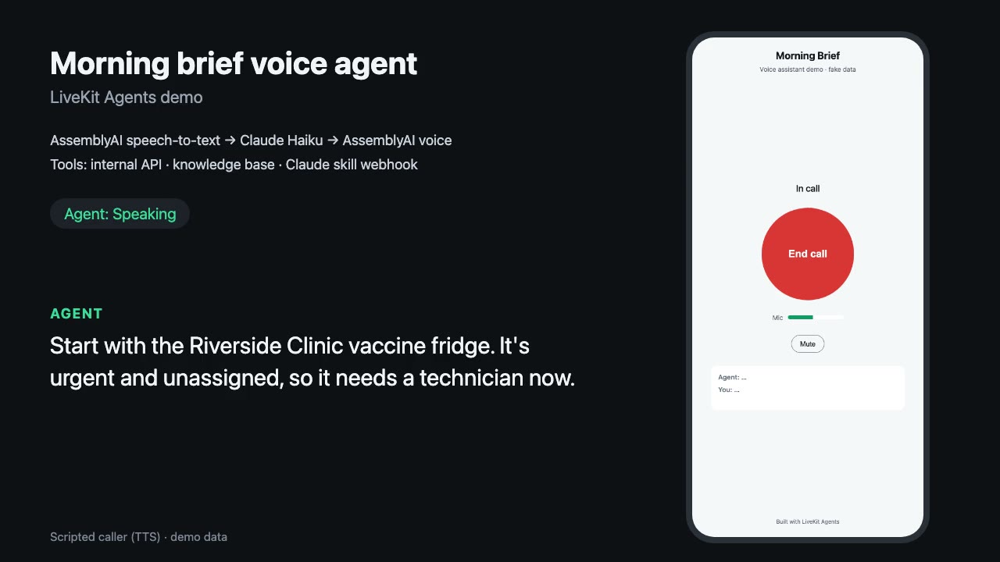

# LiveKit Voice Agent: Morning Brief demo

A small, working voice agent built on [LiveKit Agents](https://docs.livekit.io/agents/) (Python, v1.8).
You open a mobile-friendly web page, tap **Start call**, and talk to an assistant that gives you a
"morning brief" from internal systems, answers questions from a knowledge base, and can hand a
deeper question to a Claude skill behind a webhook.

It is a demo: the company (Acme Field Services), the internal API and all data are fictional.
The parts that would be swapped for real systems are clearly separated.

**Watch the 70-second demo call:** [morning-brief-demo.mp4](https://github.com/Ethan-YS/livekit-voice-agent-demo/releases/download/v0.1/morning-brief-demo.mp4) (details in [Demo](#demo))

[](https://github.com/Ethan-YS/livekit-voice-agent-demo/releases/download/v0.1/morning-brief-demo.mp4)

**What it covers**

- LiveKit Agents worker that runs on Ubuntu under systemd (restarts on crash and on reboot) and
  connects to LiveKit Cloud or a self-hosted LiveKit server, chosen by three env vars
- Voice pipeline on hosted services: speech-to-text → fast LLM → text-to-speech, plus Silero VAD
- One-button web client (phone-friendly) with a mic level meter, agent status and live captions
- Knowledge base: a folder of Markdown files, searched by a tool
- Function calling with read-only access to an internal REST API
- A webhook to an internal Claude setup: the agent sends a request, Claude runs one predefined
  read-only skill, the result comes back. While it waits, the agent says "Let me check that, one
  moment." Timeout and errors are handled and spoken gracefully.

## Architecture

```
 Phone / browser                      LiveKit (Cloud or self-hosted)
 ┌──────────────┐  WebRTC audio   ┌───────────────────────────────┐
 │ web/index.html│◄──────────────►│ room "brief-xxxx"              │
 └──────┬───────┘                 └───────────────┬───────────────┘
        │ POST /api/token                         │ dispatch "morning-brief"
 ┌──────▼────────────────┐              ┌─────────▼──────────────────────────────┐
 │ services/web.py       │              │ voice_agent (LiveKit worker, systemd)  │
 │ page + token endpoint │              │                                        │
 └───────────────────────┘              │  mic ─► AssemblyAI STT ─► LLM ─► TTS ─► speaker
                                        │         (Claude Haiku via OpenRouter)  │
                                        │                 │ tools                │
                                        │  get_morning_brief / get_open_tickets ─┼─► internal API (GET only)
                                        │  search_knowledge_base ────────────────┼─► knowledge_base/*.md
                                        │  ask_claude_skill ─────────────────────┼─► Claude webhook ─► Claude
                                        └────────────────────────────────────────┘   (one fixed skill)
```

In this repo the internal API (`services/mock_api.py`) and the Claude webhook
(`services/claude_webhook.py`) are local stand-ins. In production the agent simply points
`INTERNAL_API_URL` and `CLAUDE_WEBHOOK_URL` at the real ones.

## Providers (and why)

| Stage | Default | Why | Swap via |
|---|---|---|---|
| STT | AssemblyAI Universal streaming | accurate, low latency, has its own end-of-turn model | `STT_PROVIDER`, `STT_MODEL` |
| LLM | `anthropic/claude-haiku-5.5` via OpenRouter | fast, cheap, good at tool calling | `LLM_MODEL`, `LLM_BASE_URL` (any OpenAI-compatible API) |
| TTS | AssemblyAI streaming TTS | streaming, ~0.4 s to first audio on a warm connection | `TTS_PROVIDER=gemini`, `TTS_VOICE` |
| Claude skill | `anthropic/claude-sonnet-5.5` | stands in for the client's own Claude setup | `CLAUDE_SKILL_MODEL` |

**Turn-taking.** People pause mid-sentence, so the agent does not answer at the first gap.
LiveKit's end-of-turn model (`turn-detector-v1-mini`, runs locally, no download) listens to how
the sentence ends: if it sounds finished the agent answers after 1.2 s of silence, if it sounds
unfinished ("What's our refund policy for…") it waits up to 2.0 s. Both are env settings.

**Measured** (local LiveKit server, home network, scripted caller): the first agent audio comes
3–4.5 s after the caller stops talking on turns that call a tool, including the deliberate 1.2 s
end-of-turn wait. The Claude skill takes about 3 s more, covered by the spoken filler.

On LiveKit Cloud, set `TURN_DETECTOR_VERSION=v1` for LiveKit's hosted (larger) turn-detector
model, and consider LiveKit Inference (`stt="assemblyai/..."`, `tts="cartesia/..."` model
strings, no extra provider keys). Both need a Cloud project, so they are not used locally.

## Quick start (local, macOS or Linux)

Requirements: [uv](https://docs.astral.sh/uv/), a LiveKit server binary, and API keys for
AssemblyAI and OpenRouter (Gemini only if you use `TTS_PROVIDER=gemini`).

```bash
brew install livekit            # or: curl -sSL https://get.livekit.io | bash
uv sync                         # creates .venv with Python 3.12 and all dependencies
cp .env.example .env            # then fill in your keys
./run_local.sh                  # starts everything, logs in ./logs, Ctrl+C stops all
```

Open <http://localhost:8000> in Chrome or Safari on the same computer, tap **Start call**, allow
the microphone, and try:

- "Give me my morning brief."
- "What's our refund policy for annual plans?"
- "Ask Claude which tickets I should tackle first."

(A phone needs the page on `https://`, see deployment below.)

`run_local.sh` starts five processes: `livekit-server --dev` (port 7880), the mock internal API
(8001), the Claude webhook (8002), the web page and token endpoint (8000), and the agent worker
(`uv run python -m voice_agent dev`).

### Tests

```bash
uv run pytest                        # knowledge base, tools against the mock API and webhook,
                                     # and LLM tool-choice tests (real OpenRouter calls)
uv run python scripts/e2e_call.py    # with run_local.sh running: joins a room like the web page,
                                     # asks three spoken questions (two with a pause mid-sentence),
                                     # checks the answers and prints response times
```

## Demo

[`morning-brief-demo.mp4`](https://github.com/Ethan-YS/livekit-voice-agent-demo/releases/download/v0.1/morning-brief-demo.mp4)
(about 70 s, 1280×720, attached to the [v0.1 release](https://github.com/Ethan-YS/livekit-voice-agent-demo/releases/tag/v0.1))
is a real call recorded end to end: a scripted caller (Gemini TTS voice) joins through the token
endpoint, exactly like the web page, and asks:

1. "Give me my morning brief." → the agent calls the internal API and gives a ~20 s brief
2. "What's our refund policy for annual plans?" → knowledge-base search
3. "Ask Claude which tickets I should tackle first." → the agent says "Let me check that, one
   moment." while the Claude webhook runs, then reads back the result

Both sides of the call are recorded on one timeline (`demo/morning-brief-demo.wav`) and
nothing is cut or sped up between the first question and the last answer, so the pauses are the
real response times. The picture is the call page plus captions of who is speaking. To make a
new one, with `./run_local.sh` running (needs ffmpeg and Google Chrome):

```bash
uv run python scripts/record_demo.py
```

The video is not in git (the `demo/` folder is ignored); it lives on the release instead.

## Deploy on Ubuntu with LiveKit Cloud

1. Create a LiveKit Cloud project and copy its URL, API key and secret.
2. On the server:

   ```bash
   sudo useradd --system --create-home voiceagent
   sudo mkdir -p /opt/livekit-voice-demo && sudo chown voiceagent /opt/livekit-voice-demo
   # copy the project to /opt/livekit-voice-demo (git clone or rsync), then as voiceagent:
   curl -LsSf https://astral.sh/uv/install.sh | sh
   cd /opt/livekit-voice-demo && uv sync --frozen --no-dev
   cp .env.example .env && chmod 600 .env   # set LIVEKIT_URL=wss://<project>.livekit.cloud, keys, real API URLs
   ```

3. Install the services (see the comments at the top of each file):

   ```bash
   sudo cp deploy/livekit-agent.service deploy/voice-web.service /etc/systemd/system/
   sudo systemctl daemon-reload
   sudo systemctl enable --now livekit-agent voice-web
   ```

   `Restart=always` plus `enable` means the agent comes back after a crash and after a reboot.
   The worker connects out to LiveKit Cloud, so it needs no inbound ports.

4. Serve the page over HTTPS (browsers only give a page the microphone on https), for example
   with Caddy: `brief.example.com { reverse_proxy 127.0.0.1:8000 }`. Set `WEB_ACCESS_CODE` and
   bookmark `https://brief.example.com/?code=...` on the phone, so strangers can't start calls.

## How to change things

All settings live in `.env` (documented in `.env.example`). After a change:
**`sudo systemctl restart livekit-agent`** on the server, or Ctrl+C and `./run_local.sh` locally.
Restarting is safe: the worker finishes calls in progress before it exits.

- **Prompt / personality**: edit `voice_agent/prompt.md`. It is read at the start of every call,
  so new calls pick it up without a restart. The first sentence spoken is `GREETING` in `.env`.
- **Voice**: `TTS_VOICE` (an AssemblyAI voice id, or a Gemini voice name such as `Kore`, `Puck`,
  `Charon` with `TTS_PROVIDER=gemini`). Another TTS vendor (Cartesia, ElevenLabs, ...):
  `uv add "livekit-agents[cartesia]"` and add a branch in `voice_agent/providers.py`.
- **LLM**: `LLM_MODEL`, and `LLM_BASE_URL` / `LLM_API_KEY` for any OpenAI-compatible provider.
- **Turn-taking**: `ENDPOINTING_MIN_DELAY` (silence before answering, default 1.2 s) and
  `ENDPOINTING_MAX_DELAY` (when the sentence sounds unfinished, default 2.0 s). Raise them if
  callers get cut off, lower them for snappier replies. `STT_KEYTERMS` lists names and terms
  the recognizer should expect.
- **Knowledge base**: add, edit or delete `.md` files in `knowledge_base/` (one topic per `##`
  heading works best), then restart. For thousands of documents, replace
  `KnowledgeBase.search()` with a vector search; the tool stays the same.
- **Tools**: each tool is a method with `@function_tool` in `voice_agent/agent.py`. The docstring
  is what the LLM reads to decide when to call it; the arguments become its parameters. Backend
  calls live in `voice_agent/backends.py` (read-only `GET`s only). Add a method, restart.
- **Claude skill**: the agent sends `{"skill", "request"}` to `CLAUDE_WEBHOOK_URL` with
  `Authorization: Bearer <WEBHOOK_SECRET>` and reads `result` from the JSON reply. The demo
  skill's instructions are in `services/skills/ticket_triage_summary.md`. The holding lines are
  `CLAUDE_FILLERS` in `voice_agent/agent.py`; the wait limit is `WEBHOOK_TIMEOUT_SECONDS`.
- **Restart / status / logs**: `sudo systemctl restart livekit-agent`,
  `systemctl status livekit-agent`, `journalctl -u livekit-agent -f`.

## Project layout

```
voice_agent/        the LiveKit worker
  main.py           entrypoint: session wiring (STT, LLM, TTS, VAD, turn detection)
  agent.py          instructions + tools (function calling, filler while Claude works)
  backends.py       read-only internal API client and Claude webhook client
  knowledge_base.py Markdown loader + BM25 keyword search
  providers.py      STT / LLM / TTS factories (env-driven)
  config.py         every setting, read from .env
  prompt.md         system prompt
services/
  web.py            web page + LiveKit token endpoint (dispatches the agent)
  mock_api.py       fake internal API (GET only)
  claude_webhook.py stand-in for the internal Claude setup, one fixed skill
  skills/           the skill's instructions
web/index.html      the call page (LiveKit JS client from a pinned CDN build)
knowledge_base/     Markdown knowledge base (fictional)
deploy/             systemd units
tests/              pytest suite
scripts/            scripted caller: end-to-end check and demo recording
docs/               README image
```

## Notes and limits

- AssemblyAI's streaming TTS limits how many new sessions an account may open per minute
  (5 on the account used here). One call uses one session, so this is fine for one manager, but
  check your plan's limit, or switch TTS provider, before giving it to a team.
- LiveKit's adaptive interruption model runs on LiveKit Cloud. On a local dev server the agent
  logs that it falls back to VAD-based interruption, which is expected.
- The LiveKit SDKs use `HTTPS_PROXY` but ignore `NO_PROXY`; `voice_agent/main.py` clears the
  proxy variables when `LIVEKIT_URL` is a local address, so a machine with a proxy still works.
- Hosted APIs occasionally stall a request (seen a few times in testing, on both OpenRouter and
  AssemblyAI TTS). The agent retries after 6 s (LLM) / 2 s (TTS) without data instead of
  LiveKit's 10 s default, so a stall costs a few seconds rather than ten.
- The webhook call is synchronous with a timeout. If the real Claude setup answers by calling a
  URL back instead, the tool can wait on that callback the same way (keyed by `request_id`).

Author: Ethan Yi
